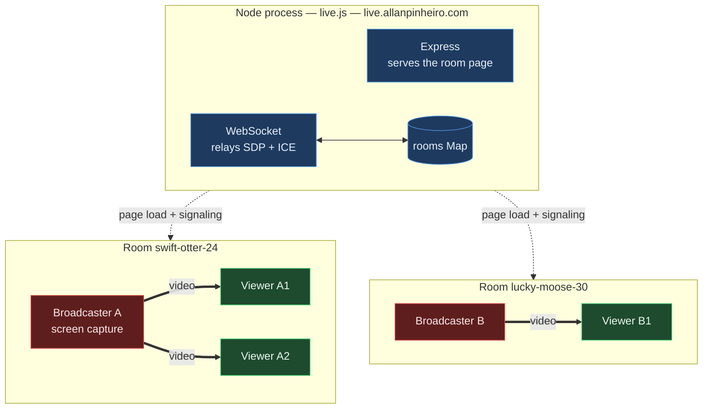

# live

Screen sharing over WebRTC in a single file. One `live.js`, two dependencies, no build step.

The server hands out a room URL and relays signaling. Video goes peer-to-peer and never touches it.

Runs at **[live.allanpinheiro.com](https://live.allanpinheiro.com)** · 🇧🇷 [página explicativa em português](https://allanhal.github.io/live/)

## Quick start

```bash
pnpm install
node live.js
```

Open the printed local URL. The first person to join a room becomes the broadcaster; everyone who opens the same URL after that is a viewer.

Set `PUBLIC_ORIGIN` to change the public URL in the startup banner (defaults to `https://live.allanpinheiro.com`), and `PORT` to change the listen port.

## Room IDs

Rooms are speakable Portuguese slugs like `onca-veloz-azul` — substantivo + adjetivo + cor, in the order the words come in when spoken, so the slug reads as a phrase and can be given over a phone instead of copied character by character. 60 x 50 x 30 is 90,000 combinations, drawn with `crypto.randomInt`.

No accents and no cedillas: the id has to survive `ROOM_ID_RE`, a URL bar, and being spelled out loud. No digits either — a number is the part people mishear.

You can also just pick your own: `/standup` or `/demo-friday` works. Any id is lowercased, canonicalised with a redirect, and must match `^[a-z0-9][a-z0-9-]{0,39}$` — anything else is a 404. That charset is load-bearing, since the id is interpolated into the page and into a JS string literal. `admin` and `healthz` are reserved, since those paths are pages of their own.

Rooms are ephemeral, so a collision only matters if both rooms are live at the same moment; with a handful of concurrent rooms that is remote, and the cost is landing in a stranger's room rather than anything persistent.

## Architecture



Dashed edges are the only traffic the server sees; thick edges are the video, which stays inside the room and never reaches the server. Rooms are fully independent — a second broadcaster means a second room, not a second load on the process.

## Does a second broadcaster cost the server anything?

Essentially nothing. The server is a signaling relay: the `offer` / `answer` / `ice-candidate` cases just forward a JSON string to the other party, and after negotiation a room goes completely silent. Budget roughly 10 KB of server traffic per viewer join, once.

Cost scales with **participant count**, not with stream quality:

| | Server | Broadcaster |
|---|---|---|
| Per room | 1 `Map` entry, 1 `Set` | — |
| Per participant | 1 WebSocket, ~10 KB of SDP + ICE | — |
| Per viewer | nothing after negotiation | a full independent encode + upload |
| Scales with bitrate | no | yes |

A 1-broadcaster/50-viewer room costs the server well under a megabyte in total, while costing the broadcaster ~125 Mbps of uplink and 50 simultaneous encodes. Ten concurrent rooms is a non-event; ten thousand idle WebSockets would be the first thing to matter, and it would be memory, not CPU.

Note that two people cannot broadcast into the *same* room — the first joiner takes the broadcaster slot and the rest become viewers. Multiple streamers means multiple rooms.

## Room lifecycle

Rooms live only in memory and only while someone is in them. A room is created when the first client sends `join` — not when a socket connects — and deleted as soon as the last participant leaves.

Dead clients are reaped by a 30s ping/pong heartbeat (`HEARTBEAT_MS`): a laptop that sleeps or a connection that drops without a TCP teardown never fires `close`, so without this its room would stay keyed to a broadcaster who is never coming back, and the next person to open the URL would join as a viewer of nothing. The same timer sweeps any room left empty.

A broadcaster leaving does **not** evict the viewers — they stay connected and waiting, the room survives, and the broadcaster slot is free for whoever takes it next.

`GET /healthz` reports `{ ok, rooms, clients, uptime }`.

## Viewer audio

A viewer's stream starts muted, because an unmuted `play()` is blocked by autoplay policy and the result is a black frame rather than a prompt. The viewer gets a mute toggle and a volume slider over the bottom-right of the video; the first move of either one is the unmute, and the level is kept in `localStorage` so the next room opens at the same volume. A level of 0 is not stored — otherwise a visit that ended silent would start the next one silent with nothing to explain it.

## Admin panel

`GET /admin` is a password-gated panel over the live room map. The password is `1111` by default — set `ADMIN_PASSWORD` anywhere the server is reachable from outside, because this page can end every stream on it. The password is sent as an `x-admin-password` header on each API call and held in `sessionStorage`, so it is gone when the tab is; eight wrong tries lock an IP out of `/admin/api/*` for a minute.

Per room: **stop stream** (drops the broadcaster, viewers stay waiting), **rename**, **close room** (disconnects everyone), and **kick** on each viewer. Below the list: **reset state** (drops every room and connection) and **restart process** (`process.exit(0)` — it only comes back if a supervisor restarts it).

Every action works by closing sockets rather than editing a room in place. The `close` handlers already know how to notify the other side and tidy up, so an admin action only adds a reason the client can show: the page stops its reconnect loop and says what happened instead of silently rebuilding the room it was just removed from. Close codes are 4010 closed, 4011 kicked, 4012 moved, 4013 reset.

Rename is a move, not a relabel. The room id is in every client's URL and in each socket's closure, so instead of rewriting that state the panel sends everyone to the new URL and lets them form the room again there. A page load cannot carry a `MediaStream`, so the broadcaster has to pick a screen again — which is why the confirm dialog says so.

## Live measurements

The broadcaster and every viewer sample `getStats()` every 2s and send a summary up the socket; the server keeps only the newest sample per participant and `/admin` polls it at the same cadence. Nothing is stored or kept as history — it is a gauge, not a time series, and a sample older than 8s is dropped rather than shown stale.

The broadcaster reports send bitrate, resolution, fps, mean encode time per frame, `qualityLimitationReason`, and how many parallel encodes it is running. Each viewer reports receive bitrate, fps, resolution, RTT, jitter, jitter-buffer delay and freeze count. Between them they separate the three different things that all get called "lag": **encode time** says the broadcaster's machine cannot keep up, **delay and freezes** say the network between them cannot, and **encodes Nx** says the mesh is the problem.

Values that matter are coloured: encode time over 20ms, delay over 400ms, loss over 3%, fps under 15.

`/admin` can also pin a quality tier, or cap bitrate and framerate outright. While a tier is pinned the monitor keeps measuring but stops steering, so an operator's choice is not undone six seconds later. Framerate is the cap that actually cuts latency on a screen share — halving fps halves what the encoder and the uplink have to keep up with, where a resolution change only shrinks each frame. Client-supplied numbers are coerced and clamped server-side before they ever reach the page.

## Known limitations


- **Mesh topology.** The broadcaster opens one `RTCPeerConnection` per viewer with no simulcast, so each viewer costs another full 1080p60 encode. This is the real ceiling on audience size, and lifting it means simulcast or an SFU rather than a change to this file. The `encodes Nx` figure in `/admin` is how you tell whether you are hitting it: with one viewer the mesh is not the problem, whatever else is.
- **STUN only, no TURN.** On symmetric NAT or a corporate network the peer connection simply fails, with no relay to fall back on. Fixing it means running coturn and opening UDP ports, which also puts video bandwidth back on a server.
- **Deployment is manual.** Nothing in the repo provisions `live.allanpinheiro.com`; the process has to be run and fronted by TLS somewhere. WebRTC screen capture requires a secure context, so plain HTTP only works on `localhost`.

## Quality control

The sender is aimed at the current tier before each offer is negotiated, and one monitor — not one per viewer — polls `qualityLimitationReason` every 2s across all peers. Three limited rounds drop a tier, eight clear rounds climb back.

The previous version compared measured throughput against the tier's `maxBitrate`. That could only ratchet down: nothing applied the tier to the sender at peer creation, so the encoder targeted the browser default of ~2 Mbps while the test asked whether throughput had reached 40% of 8 Mbps. It was true from the first sample on an idle network, so every session fell to 500 kbps within ~20 seconds and could never recover, because climbing back required saturating a bitrate the encoder had never been pointed at. A timer per viewer made it worse by racing N writers on one shared tier index.

## License

MIT
