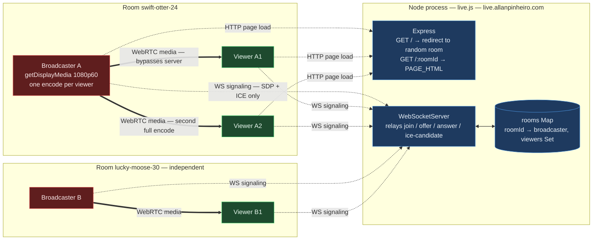

# live

Screen sharing over WebRTC in a single file. One `live.js`, two dependencies, no build step.

The server hands out a room URL and relays signaling. Video goes peer-to-peer and never touches it.

Runs at **[live.allanpinheiro.com](https://live.allanpinheiro.com)** · 🇧🇷 [página explicativa em português](https://allanhal.github.io/live/)

## Quick start

```bash
pnpm install
node live.js
```

Open the printed local URL. The first person to join a room becomes the broadcaster; everyone who opens the same URL after that is a viewer.

Set `PUBLIC_ORIGIN` to change the public URL in the startup banner (defaults to `https://live.allanpinheiro.com`), and `PORT` to change the listen port.

## Room IDs

Rooms are speakable slugs like `swift-otter-24` — 45 adjectives x 45 nouns x a two-digit number, about 182k combinations, generated with `crypto.randomInt`. They can be read over a phone instead of copied character by character.

You can also just pick your own: `/standup` or `/demo-friday` works. Any id is lowercased, canonicalised with a redirect, and must match `^[a-z0-9][a-z0-9-]{0,39}$` — anything else is a 404. That charset is load-bearing, since the id is interpolated into the page and into a JS string literal.

## Architecture



Dashed edges are the only traffic the server sees. Thick edges are the video, routed peer-to-peer.

## Does a second broadcaster cost the server anything?

Essentially nothing. The server is a signaling relay: the `offer` / `answer` / `ice-candidate` cases just forward a JSON string to the other party, and after negotiation a room goes completely silent. Budget roughly 10 KB of server traffic per viewer join, once.

Cost scales with **participant count**, not with stream quality:

| | Server | Broadcaster |
|---|---|---|
| Per room | 1 `Map` entry, 1 `Set` | — |
| Per participant | 1 WebSocket, ~10 KB of SDP + ICE | — |
| Per viewer | nothing after negotiation | a full independent encode + upload |
| Scales with bitrate | no | yes |

A 1-broadcaster/50-viewer room costs the server well under a megabyte in total, while costing the broadcaster ~125 Mbps of uplink and 50 simultaneous encodes. Ten concurrent rooms is a non-event; ten thousand idle WebSockets would be the first thing to matter, and it would be memory, not CPU.

Note that two people cannot broadcast into the *same* room — the first joiner takes the broadcaster slot and the rest become viewers. Multiple streamers means multiple rooms.

## Known limitations

- **Mesh topology.** The broadcaster opens one `RTCPeerConnection` per viewer with no simulcast, so each viewer costs another full 1080p60 encode. Past a handful of viewers this needs simulcast or an SFU.
- **STUN only, no TURN.** On symmetric NAT or a corporate network the peer connection simply fails, with no relay to fall back on. Adding TURN fixes it but puts video bandwidth on a server.
- **No WebSocket heartbeat.** A client that disappears without a TCP teardown keeps its slot. If that client was the broadcaster, the room stays occupied and the next person to open the URL becomes a viewer of nothing.
- **Viewers who arrive early get nothing.** `viewer-joined` requires `localStream` to already exist, and the Share Screen handler does not loop back over viewers who joined before it, so they wait forever.
- **The adaptive bitrate controller only ratchets down.** It compares measured throughput against a target nobody set on the sender, so the test is true from the start and quality falls to the lowest tier within ~20 seconds regardless of the network — then cannot climb back, because recovery requires saturating a bitrate the encoder was never aimed at.
- **Deployment is manual.** Nothing in the repo provisions `live.allanpinheiro.com`; the process has to be run and fronted by TLS somewhere. WebRTC screen capture requires a secure context, so plain HTTP only works on `localhost`.
- **O(N) viewer lookup.** Broadcaster-originated messages rebuild an array of every viewer to find one by id, which is O(N²) allocations across an ICE flood.

## License

MIT
