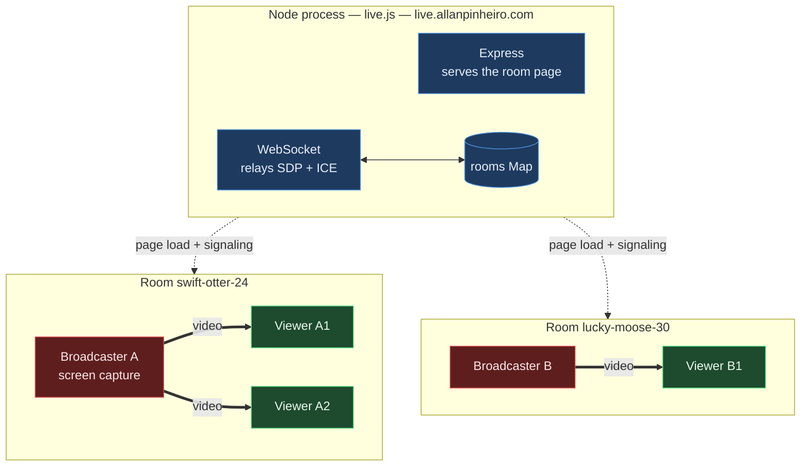

# live

Screen sharing over WebRTC in a single file. One `live.js`, two dependencies, no build step.

The server hands out a room URL and relays signaling. Video goes peer-to-peer and never touches it.

Runs at **[live.allanpinheiro.com](https://live.allanpinheiro.com)** · 🇧🇷 [página explicativa em português](https://allanhal.github.io/live/)

## Quick start

```bash
pnpm install
node live.js
```

Open the printed local URL. The first person to join a room becomes the broadcaster; everyone who opens the same URL after that is a viewer.

Set `PUBLIC_ORIGIN` to change the public URL in the startup banner (defaults to `https://live.allanpinheiro.com`), and `PORT` to change the listen port.

## Room IDs

Rooms are speakable slugs like `swift-otter-24` — 45 adjectives x 45 nouns x a two-digit number, about 182k combinations, generated with `crypto.randomInt`. They can be read over a phone instead of copied character by character.

You can also just pick your own: `/standup` or `/demo-friday` works. Any id is lowercased, canonicalised with a redirect, and must match `^[a-z0-9][a-z0-9-]{0,39}$` — anything else is a 404. That charset is load-bearing, since the id is interpolated into the page and into a JS string literal.

## Architecture



Dashed edges are the only traffic the server sees; thick edges are the video, which stays inside the room and never reaches the server. Rooms are fully independent — a second broadcaster means a second room, not a second load on the process.

## Does a second broadcaster cost the server anything?

Essentially nothing. The server is a signaling relay: the `offer` / `answer` / `ice-candidate` cases just forward a JSON string to the other party, and after negotiation a room goes completely silent. Budget roughly 10 KB of server traffic per viewer join, once.

Cost scales with **participant count**, not with stream quality:

| | Server | Broadcaster |
|---|---|---|
| Per room | 1 `Map` entry, 1 `Set` | — |
| Per participant | 1 WebSocket, ~10 KB of SDP + ICE | — |
| Per viewer | nothing after negotiation | a full independent encode + upload |
| Scales with bitrate | no | yes |

A 1-broadcaster/50-viewer room costs the server well under a megabyte in total, while costing the broadcaster ~125 Mbps of uplink and 50 simultaneous encodes. Ten concurrent rooms is a non-event; ten thousand idle WebSockets would be the first thing to matter, and it would be memory, not CPU.

Note that two people cannot broadcast into the *same* room — the first joiner takes the broadcaster slot and the rest become viewers. Multiple streamers means multiple rooms.

## Room lifecycle

Rooms live only in memory and only while someone is in them. A room is created when the first client sends `join` — not when a socket connects — and deleted as soon as the last participant leaves.

Dead clients are reaped by a 30s ping/pong heartbeat (`HEARTBEAT_MS`): a laptop that sleeps or a connection that drops without a TCP teardown never fires `close`, so without this its room would stay keyed to a broadcaster who is never coming back, and the next person to open the URL would join as a viewer of nothing. The same timer sweeps any room left empty.

A broadcaster leaving does **not** evict the viewers — they stay connected and waiting, the room survives, and the broadcaster slot is free for whoever takes it next.

`GET /healthz` reports `{ ok, rooms, clients, uptime }`.

## Known limitations

- **Mesh topology.** The broadcaster opens one `RTCPeerConnection` per viewer with no simulcast, so each viewer costs another full 1080p60 encode. This is the real ceiling on audience size, and lifting it means simulcast or an SFU rather than a change to this file.
- **STUN only, no TURN.** On symmetric NAT or a corporate network the peer connection simply fails, with no relay to fall back on. Fixing it means running coturn and opening UDP ports, which also puts video bandwidth back on a server.
- **Deployment is manual.** Nothing in the repo provisions `live.allanpinheiro.com`; the process has to be run and fronted by TLS somewhere. WebRTC screen capture requires a secure context, so plain HTTP only works on `localhost`.

## Quality control

The sender is aimed at the current tier before each offer is negotiated, and one monitor — not one per viewer — polls `qualityLimitationReason` every 2s across all peers. Three limited rounds drop a tier, eight clear rounds climb back.

The previous version compared measured throughput against the tier's `maxBitrate`. That could only ratchet down: nothing applied the tier to the sender at peer creation, so the encoder targeted the browser default of ~2 Mbps while the test asked whether throughput had reached 40% of 8 Mbps. It was true from the first sample on an idle network, so every session fell to 500 kbps within ~20 seconds and could never recover, because climbing back required saturating a bitrate the encoder had never been pointed at. A timer per viewer made it worse by racing N writers on one shared tier index.

## License

MIT
